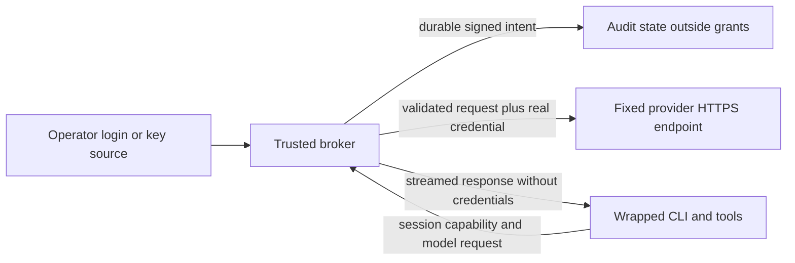

# Credential broker: API keys and subscription OAuth

Status: proposed; design only, no broker implementation or supported configuration added.

Evidence checked: 2026-10-27. NockLock baseline: next at `48fcf7497fd7fd30896dffbc0762190ce466a81a`. Codex source inspected at v0.157.1, commit `36650394c5b38c2990ccf2a3457165ca3e9d9726`. Provider documentation is mutable; qualify exact client versions before implementation or support claims.

## Recommendation

Build an opt-in local broker that holds provider credentials outside the wrapped process tree and issues a per-session capability for narrowly allowed model operations. Start with a synthetic custody proof and the OpenAI API adapter, then qualify **Codex subscription OAuth through Sign in with ChatGPT** as a separate required milestone. Add the Claude API adapter on the same boundary. Do not describe API-key coverage as solving subscription custody.

**Claude subscription OAuth is outside the proposed broker scope.** Current Anthropic guidance prohibits developers collecting, storing or intermediating Claude.ai credentials/session tokens. Retain the existing native Claude Code subscription path with its explicit credential-exposure limitation; do not silently substitute paid API usage. Revisit only if Anthropic supplies an applicable supported custody mechanism or agreement. [Anthropic credential-use guidance][claude-legal]

## What changes from today's fence

The [Claude Code preset](../../internal/config/presets/claude-code.toml) passes `ANTHROPIC_API_KEY` and `CLAUDE_CODE_OAUTH_TOKEN`; the [Codex preset](../../internal/config/presets/codex.toml) passes `OPENAI_API_KEY`. Both exempt their own login store. Environment filtering therefore protects other credentials while deliberately delivering the selected runtime's credential to the child. A credential helper that prints the real token to that child has the same limitation.

The [mandatory policy resolver](../../internal/fence/fs/builtins.go) and [secret fence](../how-it-works/secret-fence.md) are the integration points for removing that exemption in broker mode. Merely unsetting an environment variable is insufficient when the original login store remains readable. The Codex preset currently permits `api.openai.com`, but not `chatgpt.com`; its login-store allowance is not evidence that the native subscription workflow works end to end.

The [durable audit gate](../how-it-works/network-fence.md) records intent before an explicit proxy request or CONNECT dial. Encrypted CONNECT traffic remains opaque: it cannot replace provider headers or authorize individual model requests. The proposed broker terminates a deliberately configured local API connection and originates provider HTTPS itself; it does not intercept arbitrary TLS.

## Four authentication cases

| Client and mode | Documented integration | Proposed custody and coverage |
|---|---|---|
| Claude Code, API key | `ANTHROPIC_BASE_URL` selects a Messages gateway; `ANTHROPIC_AUTH_TOKEN` supplies gateway bearer authentication. | Child gets only a session capability. Broker injects the owner's Anthropic API key into the fixed upstream request. Candidate adapter; not tested yet. |
| Claude Code, subscription OAuth | Native Claude login or `claude setup-token`; the latter exposes a real token through `CLAUDE_CODE_OAUTH_TOKEN`. | No broker support under current provider guidance. Existing native mode retains its exposure. No token scraping, fake subscription tokens, or automatic API-key fallback. |
| Codex, API key | Custom Responses provider with `base_url`, `env_key`, and `requires_openai_auth=false`. | Child gets a broker capability through the custom provider's environment key. Broker holds the real OpenAI API key. First implementation candidate. |
| Codex, ChatGPT subscription | Sign in with ChatGPT (SIWC) has a documented open-source/local-app flow granting eligible Responses API use against the user's plan. | Separate broker-owned registration and consent; access, refresh and ID tokens stay outside the child. Qualify a custom Responses provider with the local capability. Promising documented building blocks, but this combination is unproven. |

Sources: [Claude gateway connection][claude-connect], [Claude authentication][claude-auth], [Codex authentication][codex-auth], [SIWC plan usage][siwc].

A plan entitlement is not an API key or an API billing balance. Explicitly select provider, account/workspace and billing mode before launch. Authentication failure or exhausted plan usage must never switch accounts, use a different credential source, or enable API billing automatically.

### Codex subscription: use an app grant, not the native auth cache

OpenAI's SIWC documentation now covers open-source, locally hosted apps; paid or remotely hosted offerings have a separate interest process. NockLock's local proposal must stay within the applicable scope and recheck availability before implementation. An existing ChatGPT subscription alone does not establish that a selected model or request is eligible. [SIWC scope][siwc]

Keep three mechanisms distinct:

- Native Codex ChatGPT login caches provider tokens. Its documented enterprise gateway path forwards the user's OpenAI authorization from Codex to the gateway. That preserves subscription routing but still gives Codex the token, so it does not meet this proposal's custody objective. [Gateway authentication][codex-gateway]
- App-server external-token mode accepts an access token from its host. Supplying that token to an app-server inside the fence also fails the custody objective. Moving the whole tool-executing app-server outside the fence would enlarge the trusted boundary and is not this design. [App-server authentication][codex-app]
- SIWC creates a distinct application grant. Its example passes an access token into app-server; **our proposed adaptation** instead points the custom provider at the local broker and passes only a capability. The broker sends the SIWC access token to the public Responses API. This is an architectural inference from the documented interfaces, not a provider-tested NockLock recipe. [SIWC app-server example][siwc-codex]

Registration happens in a trusted operator action before the child starts. Use the provider's browser flow with fresh state, nonce and S256 PKCE; validate callback, ID-token signature/issuer/audience/nonce, selected identity and returned plan-use scopes. Persist the issued client ID and stable opaque host ID. Do not copy Codex's client identity, reuse its auth cache, or register a new app each run. [Registration contract][siwc-signin]

The new grant uses `https://api.openai.com/v1`, not the native ChatGPT backend. Initially qualify HTTP/SSE only: `store=false`, `stream=true`, full request history, and the documented tool/field restrictions. Disable WebSockets in the client profile and reject upgrades at the broker. A static model list is not an entitlement check. Unsupported client features must fail visibly rather than alter the request or obtain another credential. CLI interactive and noninteractive modes need separate proofs; success with app-server alone is not proof for `nocklock wrap -- codex`. [Inference contract][siwc-inference], [preview limits][siwc-limits]

### Claude subscription: preserve the distinction

An `apiKeyHelper` may return a broker capability in API mode, but returning a real subscription token exposes it to the child. A loopback base URL or a successful synthetic request does not establish permission to intermediate subscription credentials. No Claude OAuth login, refresh, token export or subscription adapter is proposed. The existing direct token path remains available outside broker mode, with no custody claim. Anthropic's own gateway is not evidence that a third-party broker can reuse personal subscription tokens. [Claude authentication][claude-auth], [credential-use guidance][claude-legal]

## Trust boundary and request flow

The trusted computing base is the installed launcher, broker, policy and credential store, audit writer, OS enforcement, TLS stack and provider. The wrapped CLI, tools, repository and their settings are untrusted. A hostile host administrator, compromised OS or unrelated unfenced same-user process is outside this guarantee. A child escape into broker memory or storage is a failure, not an excluded case.

1. Resolve trusted policy and credential source before launch. Broker configuration cannot come from repository-controlled commands. For API keys, use an explicitly selected owner-protected source or a private input descriptor; never command arguments. Remove provider credentials from child environments and close inherited source descriptors. No automatic vault/keychain enumeration.
2. Create a separate broker process with only the selected credential. Place its state outside every child grant; require trusted parents, owner-only files and symlink-safe operations. Give the runtime a fresh credential-free configuration directory and explicitly selected nonsecret settings. Deny its original login stores, alternate homes, backups and keychain access; reject conflicting grants. Do not copy whole credential/config directories.
3. Establish an enforced child-to-broker network route, then issue a cryptographically random, expiring, single-session capability. Bind it server-side to provider, account, auth mode, policy digest and allowed operations. It is intentionally readable by the child and permits those operations; it is not proof of which child tool sent a request. Revoke it on exit or account change. Never forward it upstream. Bind only loopback, validate Host/Origin, reject browser cross-origin requests, and authenticate every request; loopback alone is not authentication.
4. Parse a bounded request, authenticate the capability, apply route/model/body policy and reserve request/concurrency quotas atomically. Reject ambiguity before any credentialed forwarding. Reconstruct headers from an adapter-specific set, replace authorization, and use a fixed HTTPS origin with normal certificate verification and redirects disabled. Reject CONNECT, absolute-form URLs, userinfo, encoded path escapes, conflicting framing, unapproved query keys and upstream selection in headers or bodies.
5. Commit a signed intent **for each outbound attempt**, including pooled connections and retries, before sending any upstream bytes. Reuse the durable writer's row/head transaction. Broker mode requires this even when ordinary proxy durable auditing is off. Audit failure means zero new upstream connection or forwarded request, cancellation and a failed run; initialization failure means no child. Record outcome separately, since intent does not prove delivery.
6. Stream responses with bounded buffers, backpressure and cancellation. Strip credential-bearing response headers and suppress secret-bearing diagnostics. No request/response dumps or raw auth error bodies in audit logs. End-of-stream is not a success verdict. Broker death or loss of its control channel cancels the run; never launch a direct-credential fallback.

A separate same-UID process and mode-0600 files do not by themselves protect against the wrapped child. Native proofs must cover process inspection/attach, process environment and descriptor paths, crash dumps, filesystem aliases and local IPC on both supported OSes. A dedicated identity or stronger isolation may be necessary; selecting that mechanism is a blocker for a custody claim. Go heap zeroization cannot be promised; minimize copies and disable dumps, and document residual swap/memory limits.

Network integration is also unfinished. The current netns helper cannot simply reach a host loopback listener or supply the required broker audit acknowledgment. The existing explicit proxy's ADVISORY level is insufficient for the proposed enforced mode. Qualify a narrowly bound endpoint on each backend and refuse unsupported combinations; do not weaken private-address restrictions globally or broaden all localhost/Unix-socket access. Kernel/platform skips are not passes.

## Narrow adapters and lifecycle

| Adapter | Initial candidate operations | Explicit exclusions |
|---|---|---|
| Anthropic API | `POST /v1/messages`; separately qualified token counting. Permit only the documented `beta=true` query when needed. Preserve required protocol/version headers from the qualified set. | Arbitrary URLs, account administration, files/batches, OAuth endpoints, generic tunnels. Unknown beta capabilities need qualification. |
| OpenAI API | `POST /v1/responses`; only necessary, separately qualified model discovery or compaction routes. | Generic OpenAI proxy, unrelated APIs, WebSocket upgrades and unqualified server-side tools. |
| OpenAI SIWC | `POST /v1/responses` and broker-controlled account model discovery under the SIWC contract. | Native backend endpoints, unsupported preview fields/tools, persistent server conversation state, billing-mode fallback. |

The table is a proposed allowlist, not a promise of full CLI feature compatibility. Claude has direct auxiliary traffic outside its gateway path; keep those features outside the claim unless separately qualified. Model, request size, concurrency and request-rate limits must be enforceable; provider-hosted tools and URL inputs can create authority beyond a method/path rule. Default to local function-tool workflows and reject unsupported remote-tool semantics. Exact cost ceilings are not promised from request counts. [Claude protocol behavior][claude-protocol]

For OAuth, serialize refresh per registration across processes, bound deadlines/retries and atomically replace the access/refresh/ID-token record as applicable, expiry and scopes. A failed persistence or validation step prevents further inference; do not reuse a consumed refresh token or overwrite the active account with a different identity. Protect OAuth exchange and refresh with separate fixed destinations and signed intents; they are not child-callable broker routes. Reauthorization is an operator action. Local logout revokes capabilities and deletes local credentials; provider-side disconnection is a separate documented action, not implied by file deletion. [Token lifecycle][siwc-sessions]

Keep the selected auth mode immutable during a session. No transparent retry of a possibly accepted inference request: duplication can spend quota twice. A permitted retry needs a new intent and quota reservation. After revocation or account switch, terminate active streams and require a fresh session; already accepted provider work cannot be recalled.

Audit only session/attempt identifiers, adapter and policy versions, opaque account reference, operation, model, bounded outcome category and timing/usage when available. Exclude tokens, authorization URLs, emails, prompts, raw headers and request bodies. Add a dedicated broker policy digest without secret values. Preserve all current non-broker defaults; exact CLI/TOML names remain undecided, and unknown config keys must continue to fail.

## Required evidence before support

| Proof | Denied case | Allowed control |
|---|---|---|
| Credential custody | Synthetic provider secrets absent from child environment, argv, files, inherited descriptors, helper output and process inspection; original login stores inaccessible. | Broker can read its designated source and the fake provider receives the real synthetic credential. |
| Capability isolation | Missing, wrong, expired, revoked or cross-session capability; tampered account/provider binding. | Correct capability works only for its configured adapter and session. |
| Route containment | Redirects, DNS/private-address tricks, malicious Host, encoded paths, extra query keys, framing ambiguity, injected auth and arbitrary upstream selection. | Qualified Messages/Responses requests, required headers and streaming pass unchanged where required. |
| Durable ordering | Missing signer, insert/head/commit failure, pooled connection after audit loss, OAuth refresh audit failure. Assert zero new upstream sockets **and zero forwarded requests on existing sockets**. | Independent reader verifies signed intent before fake provider sees the request; include token exchange/refresh. |
| OAuth lifecycle | Invalid state/nonce/issuer/audience/scope/account, expired/revoked grant, refresh race, crash during rotation, lost storage, plan exhaustion. | Synthetic PKCE flow, serialized rotation and restart preserve the same registration; no paid API fallback. |
| Runtime compatibility | Child changes config/provider/home, bypasses proxy, runs curl directly, enables unsupported tools or reads broker state. | Exact-version Claude API and Codex API/OAuth CLI sessions complete streaming, tool round trip, follow-up, cancellation and resume as advertised. |
| Failure cleanup | Broker dies, listener is rebound, capability is replayed after exit, response is truncated or contains credential-bearing diagnostics. | Child exits predictably, secrets stay out of audit/output and a fresh authorized session works. |

Use local synthetic credentials and provider servers for adversarial and mutation tests. Remove only the credential-store deny, capability check or audit gate and show its corresponding regression fails. Run native allow/deny controls on each claimed OS. A separate opt-in real-provider qualification, with an operator-authorized test account, is needed for subscription entitlement and CLI compatibility; neither docs review nor a fake OAuth server proves those.

## Alternatives, limits and next decision

nono demonstrates the proxy-held credential/session-token pattern in [credential storage][nono-credential] and [reverse routing][nono-reverse] at the previously inspected commit. Codex itself ships an [API proxy][codex-proxy] that reads a key from stdin and injects it for a narrow Responses route; its [implementation][codex-proxy-code] is useful precedent, not a drop-in NockLock custody or audit proof. Prefer a small integrated adapter over adopting a second generic gateway and its configuration surface.

A generic TLS interception proxy would add certificate trust and a much larger parser surface. Credential helpers only solve custody when they return a broker capability. Trusting the full model client outside the fence would require a new tool-execution architecture. These alternatives are deferred.

This design prevents recovery of the provider credential from the child when its boundary is proven. The child can still use its live capability, consume authorized quota and send permitted data to the provider. It does not solve prompt injection, malicious use of an allowed operation, all data exfiltration, unrelated MCP credentials or hosted provider tool access.

Next decision: agree on the narrow local scope, the OS/process isolation proof, and a Codex SIWC compatibility spike before implementing authentication storage. API-only progress must be labeled API-only. Claude subscription custody remains an explicit unsupported case. Rollback for any future opt-in implementation is to refuse broker sessions and remove the feature; never downgrade those sessions to exposed credentials automatically.

[claude-legal]: https://code.claude.com/docs/en/legal-and-compliance#authentication-and-credential-use
[claude-auth]: https://code.claude.com/docs/en/authentication
[claude-connect]: https://code.claude.com/docs/en/llm-gateway-connect
[claude-protocol]: https://code.claude.com/docs/en/llm-gateway-protocol
[codex-auth]: https://developers.openai.com/codex/auth
[codex-gateway]: https://learn.chatgpt.com/docs/enterprise/connect-to-a-gateway#enable-chatgpt-sign-in-recommended
[codex-app]: https://developers.openai.com/codex/app-server
[siwc]: https://developers.openai.com/siwc/token-sharing-open-source
[siwc-signin]: https://developers.openai.com/siwc/token-sharing-open-source/sign-in
[siwc-inference]: https://developers.openai.com/siwc/token-sharing-open-source/models-and-inference
[siwc-sessions]: https://developers.openai.com/siwc/token-sharing-open-source/profiles-and-sessions
[siwc-codex]: https://developers.openai.com/siwc/token-sharing-open-source/codex-app-server
[siwc-limits]: https://developers.openai.com/siwc/token-sharing-open-source/preview-limitations
[codex-proxy]: https://github.com/openai/codex/blob/36650394c5b38c2990ccf2a3457165ca3e9d9726/codex-rs/responses-api-proxy/README.md
[codex-proxy-code]: https://github.com/openai/codex/blob/36650394c5b38c2990ccf2a3457165ca3e9d9726/codex-rs/responses-api-proxy/src/lib.rs
[nono-credential]: https://github.com/nolabs-ai/nono/blob/11d9e6b8e522a87325134e5399cc458f11e5bba7/crates/nono-proxy/src/credential.rs
[nono-reverse]: https://github.com/nolabs-ai/nono/blob/11d9e6b8e522a87325134e5399cc458f11e5bba7/crates/nono-proxy/src/reverse.rs
